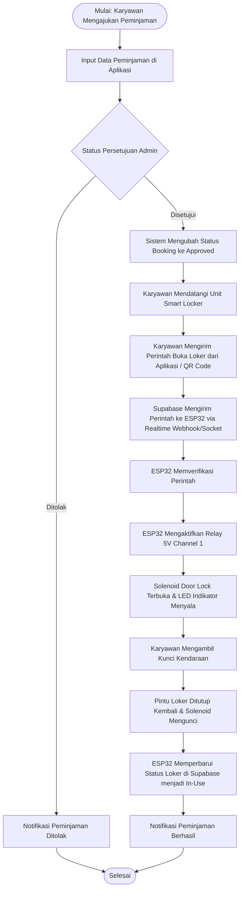
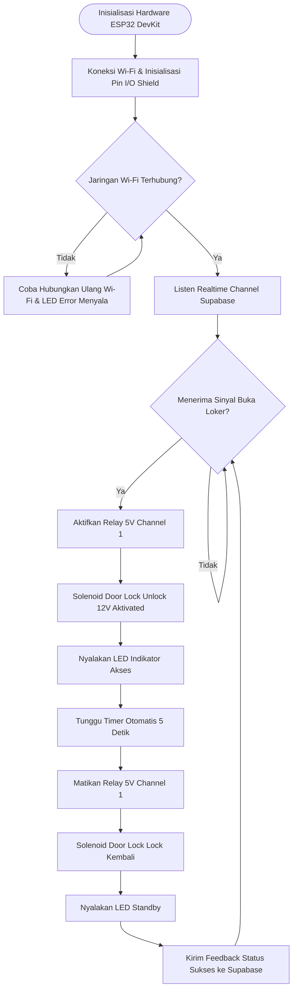
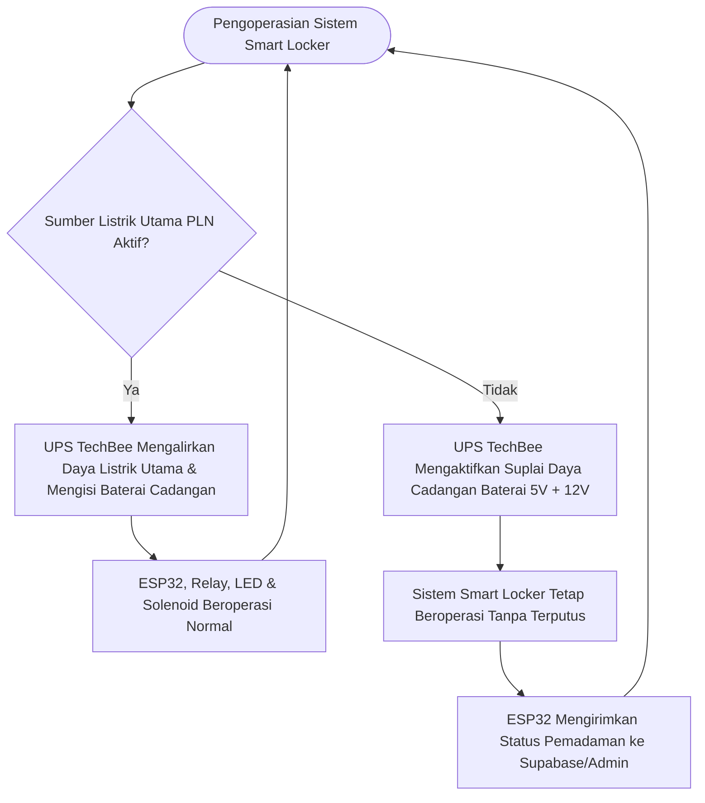

# Product Requirement Document (PRD)
## Smart Locker Key Management & Fleet Monitoring System

---

## 1. Dokumen Informasi & Ringkasan Eksekutif

| Parameter | Keterangan |
| :--- | :--- |
| **Nama Produk** | Smart Locker Key Management & Fleet Monitoring System |
| **Versi Dokumen** | 1.0.0 |
| **Tanggal** | 25 September 2026 |
| **Status** | Final / Approved |
| **Target Pengguna** | Admin Operasional Telkom, Manager Armada, & Karyawan Peminjam Kendaraan |

---

## 2. Latar Belakang & Tujuan

### 2.1 Latar Belakang
Pengelolaan kunci kendaraan operasional armada (fleet management) secara konvensional sering kali menghadapi kendala seperti hilangnya riwayat peminjaman, resiko kunci hilang atau tertukar, serta ketidaktersediaan sistem pemantauan status loker secara real-time. Untuk meningkatkan keamanan, transparansi, dan efisiensi operasional, diperlukan loker penyimpanan kunci pintar (Smart Locker) yang terintegrasi langsung dengan platform Cloud Database dan Aplikasi Admin Monitoring.

### 2.2 Tujuan Utama
1. **Otomatisasi Akses Loker:** Mengontrol penguncian dan pembukaan pintu loker kunci menggunakan Solenoid Lock yang dikendalikan oleh ESP32 Microcontroller secara otomatis berbasis verifikasi sistem.
2. **Integrasi Real-Time Cloud:** Menghubungkan loker fisik dengan Supabase Cloud Database untuk sinkronisasi status peminjaman, pengembalian, dan riwayat akses secara instan.
3. **Monitoring Admin:** Memfasilitasi Admin Operasional melalui aplikasi Flutter untuk menyetujui peminjaman, melacak armada, dan mengontrol loker.
4. **Resiliensi Daya Sistem:** Menjamin ketersediaan sistem loker tetap aktif bahkan saat terjadi pemadaman listrik dengan menggunakan UPS TechBee backup power (5V + 12V).

---

## 3. Ruang Lingkup Sistem (Product Scope)

Sistem ini mencakup 3 (tiga) pilar utama:
1. **Perangkat Keras (Hardware IoT Smart Locker):**
   - Microcontroller ESP32 DevKit Type-C dengan Shield I/O 30 Pin.
   - Modul Relay 5V 2 Channel sebagai saklar elektronik penggerak Solenoid Door Lock.
   - Solenoid Door Lock 12V untuk mekanisme penguncian pintu loker fisik.
   - LED Indikator (6 unit) sebagai penanda visual status pintu & aktivitas.
   - Unit Pengisian & Cadangan Daya UPS TechBee (5V & 12V) untuk suplai daya mandiri.
   - Kotak Enclosure / Penyimpanan Kunci fisik beserta pengkabelan terintegrasi (AWG 20, Jumper, JST, Connector).
2. **Backend & Cloud Database:**
   - Database Supabase untuk autentikasi pengguna, penyimpanan data transaksi peminjaman, status armada, dan logging real-time.
3. **Aplikasi Admin Monitoring (Flutter):**
   - Dashboard monitoring armada, persetujuan peminjaman, lacak lokasi GPS kendaraan, dan kontrol status loker.

---

## 4. Kebutuhan Pengguna & Spesifikasi Fungsional

### 4.1 Autentikasi & Otorisasi
- **FR-1.1:** Admin dan Karyawan wajib melakukan login terautentikasi melalui Supabase Auth.
- **FR-1.2:** Pengguna hanya dapat mengakses loker apabila transaksi peminjaman kendaraan telah berstatus disetujui (*Approved*).

### 4.2 Kontrol Hardware IoT & Firmware (ESP32)
- **FR-2.1:** ESP32 menghubungkan diri ke jaringan Internet/Wi-Fi dan melakukan *polling* atau mendengarkan pesan real-time dari Supabase.
- **FR-2.2:** Ketika sinyal perintah buka pintu diterima, ESP32 memicu Relay Channel 1 untuk menyalurkan daya ke Solenoid Door Lock selama durasi tertentu (contoh: 5 detik).
- **FR-2.3:** LED Indikator menyala sesuai status (misal: LED Standby, LED Terbuka, LED Error/Peringatan).

### 4.3 Monitoring Armada & Riwayat Peminjaman
- **FR-3.1:** Aplikasi Flutter Admin menampilkan ringkasan status loker dan armada kendaraan secara real-time.
- **FR-3.2:** Setiap aksi pembukaan loker dicatat lengkap dengan timestamp, ID peminjam, ID kendaraan, dan ID admin penanggung jawab.

---

## 5. Diagram Alur Sistem (Flowcharts)

Berikut adalah diagram alur proses kerja sistem Smart Locker yang disajikan menggunakan **Flowchart**:

### 5.1 Flowchart 1: Alur Utama Peminjaman Kendaraan & Pengambilan Kunci Loker

### 5.2 Flowchart 2: Alur Eksekusi Firmware ESP32 & Kontrol Hardware

### 5.3 Flowchart 3: Alur Manajemen Daya & Backup UPS TechBee

---

## 6. Rencana Anggaran Biaya (RAB)

Seluruh estimasi biaya komponen perangkat keras dan biaya operasional bulanan berikut mengacu tepat pada dokumen anggaran Smart Locker yang telah disepakati:

### 6.1 Biaya Perangkat Keras (Hardware Smart Locker)

| No. | Komponen | Qty | Estimasi Harga/unit | Subtotal |
| :---: | :--- | :---: | :---: | :---: |
| **1.** | ESP32 DevKit Type-C | 1 | Rp88.500 | Rp88.500 |
| **2.** | I/O Expansion Shield ESP32 (30 Pin) | 1 | Rp46.000 | Rp46.000 |
| **3.** | Relay 5V 2 Channel | 1 | Rp24.500 | Rp24.500 |
| **4.** | Solenoid Door Lock | 1 | Rp40.750 | Rp40.750 |
| **5.** | LED 5mm 5v-12v | 6 | Rp4.900 | Rp29.500 |
| **6.** | Penyimpanan Kunci | 1 | Rp225.500 | Rp225.500 |
| **7.** | UPS TechBee Output 5v+12v | 1 | Rp264.000 | Rp264.000 |
| **8.** | Kabel Jumper | 3 | Rp18.600 | Rp56.000 |
| **9.** | Dioda in 4007 | 1 | Rp1.500 | Rp1.500 |
| **10.** | Kabel Jst | 2 | Rp1.500 | Rp3.000 |
| **11.** | Konektor kabel 2-6 | 2 | Rp14.000 | Rp28.000 |
| **12.** | Konektor kabel 2-2 | 8 | Rp3.600 | Rp29.000 |
| **13.** | Kabel awg 20 (hitam dan merah) (2m) | 4 | Rp3.000 | Rp12.000 |
| **TOTAL** | | | | **Rp848.250** |

---

### 6.2 Kebutuhan Biaya Operasional Bulanan

| Kebutuhan | Keterangan | Estimasi/Bulan |
| :--- | :--- | :---: |
| **Cloud Database (Supabase)** | Untuk Database | **±Rp 450.000 / bulan** |

---

## 7. Kebutuhan Non-Fungsional (Non-Functional Requirements)

1. **Reliabilitas Daya & Backup:** Unit UPS TechBee (5V & 12V Output) harus mampu menyediakan cadangan daya minimal 4-6 jam saat listrik PLN padam agar loker tetap dapat diakses.
2. **Waktu Respon (Latency):** Pembukaan Solenoid Door Lock dari eksekusi perintah di aplikasi hingga pengaktifan relay ESP32 harus di bawah 2 detik.
3. **Keamanan (Security):** 
   - Modul Solenoid dipasang dari bagian dalam chasis Penyimpanan Kunci untuk mencegah pembukaan paksa dari luar.
   - Komunikasi data antara ESP32, Aplikasi Flutter, dan Supabase terlindungi enkripsi SSL/TLS (HTTPS & WSS).
4. **Ketahanan Komponen:** Dioda 1N4007 terpasang secara pararel balik (flyback diode) pada Solenoid Door Lock untuk menyerap lonjakan tegangan balik (inductive spike) demi melindungi Relay dan ESP32.

---

## 8. Pemeliharaan & Matriks Verifikasi

- **Pengujian Perangkat Keras:**
  - Verifikasi pengkabelan AWG 20 dan konektor (2-2 dan 2-6) tidak longgar.
  - Pengujian daya UPS TechBee saat saklar utama dilepas.
- **Pengujian Firmware & Sistem:**
  - Pengujian simulasi kehilangan sinyal Wi-Fi dan auto-reconnect ESP32.
  - Pengujian stres eksekusi Relay & Solenoid 100x pembukaan berturut-turut.
